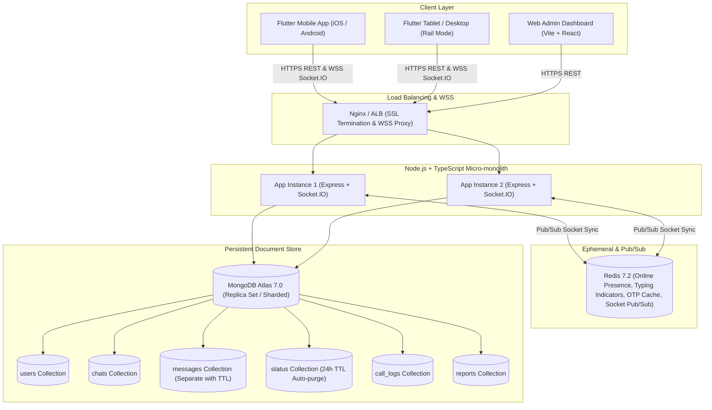

# Namasty - Messenger (MongoDB & Redis Architecture)
> **Tagline:** *"Namasty! Baat karo, dil se."*  
> **Package ID:** `com.namasty.messenger`  
> **Database Engine:** MongoDB (Mongoose ODM) for all data + Redis for high-speed ephemeral presence, typing & Socket.IO Pub/Sub

---

## 1. High-Level MongoDB Architecture



---

## 2. MongoDB Collection Schemas & Index Strategy

### 1. `users` Collection
- **Indexes:**
  - `{ phoneNumber: 1 }` (unique, sparse)
  - `{ isOnline: 1, lastSeen: -1 }`

### 2. `chats` Collection
- Stores 1-to-1 direct chats, group chats (up to 1024 members), and broadcast channels.
- Participants are embedded as subdocuments for single-query participant validation.
- **Indexes:**
  - `{ "participants.userId": 1 }`
  - `{ inviteCode: 1 }` (unique, sparse)
  - `{ updatedAt: -1 }`

### 3. `messages` Collection (Separate Collection)
- High throughput, decoupled from chat documents to prevent document size growth (16MB BSON limit).
- **Indexes:**
  - **Cursor Pagination Compound Index:** `{ chatId: 1, createdAt: -1 }`
  - **Disappearing Messages TTL Index:** `{ expiresAt: 1 }` with `{ expireAfterSeconds: 0 }` (MongoDB background thread automatically removes expired messages).

### 4. `status` Collection (24-Hour Stories)
- **TTL Index:** `{ expiresAt: 1 }` with `{ expireAfterSeconds: 0 }`
  - Defaults to `createdAt + 24 hours`. MongoDB automatically purges documents when 24 hours elapse.
  - `{ userId: 1, createdAt: -1 }`

### 5. `call_logs` Collection
- Stores WebRTC voice/video calls.
- **Indexes:** `{ callerId: 1, startedAt: -1 }`, `{ recipientIds: 1, startedAt: -1 }`

### 6. `reports` Collection
- Moderation reports for spam/abuse.
- **Indexes:** `{ status: 1, createdAt: -1 }`

---

## 3. Cursor-Based Message Pagination

Instead of slow `OFFSET` / `skip()` queries, Namasty uses **Keyset / Cursor Pagination**:
```typescript
// Query: GET /api/v1/chats/:chatId/messages?limit=30&before=2026-10-31T07:00:00.000Z
const query: any = { chatId };
if (before) {
  query.createdAt = { $lt: new Date(before) };
}

const messages = await MessageModel.find(query)
  .sort({ createdAt: -1 })
  .limit(limit)
  .lean();

// Returned in chronological order with nextCursor
messages.reverse();
const nextCursor = messages.length > 0 ? messages[0].createdAt.toISOString() : null;
```

---

## 4. Production Deployment with MongoDB Atlas

1. **Create Atlas Cluster:**
   - Log into MongoDB Atlas and create an M10+ replica set cluster in `ap-south-1` (Mumbai) for minimum latency in India.
2. **Database User & IP Access:**
   - Add database user with `readWrite` permissions on `namasty_messenger`.
   - Add IP Access list / VPC Peering for backend servers.
3. **Environment String:**
   ```env
   MONGODB_URI=mongodb+srv://namasty_app:<password>@cluster0.namasty.mongodb.net/namasty_messenger?retryWrites=true&w=majority&appName=NamastyCluster
   ```
